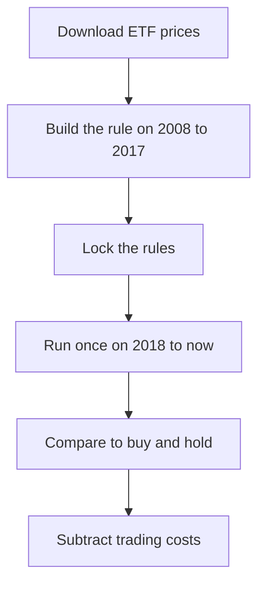

# Idea: Trend Following on Commodity ETFs

**Vignesh 10/13/2026**

We take five commodity ETFs and apply one simple rule to each of them. At the end of every month we look at how the ETF did over the last 12 months. If it went up, we hold it for the next month. If it went down, we sit in cash instead. Each ETF gets an equal 20% slot in the portfolio.

The five ETFs would be GLD (gold), SLV (silver), USO (oil), UNG (natural gas), and DBA (agriculture).

## Why I think it's good

I think this is a good first project because it's simple enough that we can actually finish it and explain every part of it. There is one rule and one parameter, and all the data is free from Yahoo Finance.

The economics also make sense to me. Commodity supply is slow to react, since you can't open a mine or grow a crop overnight. So when there's a shortage or a glut, prices tend to keep moving the same way for a while, and a trend rule is a way to ride that.

It's also a well-known effect (Moskowitz, Ooi, and Pedersen wrote the main paper on it in 2012), so we'd be testing something real and not something we made up. And since we're using ETFs, we don't have to build futures rolls ourselves. The roll cost is already inside the price of USO, UNG, and DBA, and we can still explain rolls by plotting those against spot prices.

## How we'd test it

We'd compare the strategy against just buying and holding the same five ETFs at equal weight. That way the only difference between the two is the trend rule.

To keep ourselves honest, we'd build everything on 2008 to 2017 data, lock the rules, and then run it one time on 2018 to now.

For trading costs we'd assume 5 bps per trade, then try 10 and 20 to see if the result still holds up. The numbers we'd report for both the strategy and the baseline are

- Return and volatility
- Sharpe ratio
- Max drawdown
- Turnover

## What could go wrong

With only five assets the results are going to be noisy, and a few big events like 2008 and 2020 will probably drive most of it. Trend following also did badly for most of the 2010s, so I think we're more likely to see smaller drawdowns than bigger returns.

If it doesn't work on the held-out data, that's fine. We report it and explain why.

## If we have extra time

- Weight by volatility so natural gas doesn't dominate
- Add a long/short version
